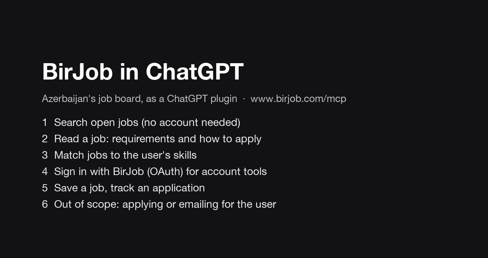

# BirJob MCP server

Search Azerbaijan's job market from any MCP client.

[BirJob](https://www.birjob.com) reads more than 120 Azerbaijani job sites and employers' career pages, about 90 of them with open vacancies at any time, and lists each job once (about 10,000 open jobs). It also lists jobs in Uzbekistan, Kazakhstan, Turkey, Georgia and Kyrgyzstan.

BirJob runs a remote MCP server, so ChatGPT, Cursor, VS Code, Gemini CLI, Kiro, Raycast, Windsurf and any other MCP client can search those jobs, read a posting with its apply link and rank jobs against a CV. Every job and employer in a result links to its page on birjob.com.

This repository holds no code: only the server's address, a Gemini CLI extension manifest and these setup notes.

| | |
|---|---|
| Endpoint | `https://www.birjob.com/mcp` |
| Transport | Streamable HTTP |
| Sign-in | None for search; OAuth 2.1 for the account tools |
| MCP Registry | `com.birjob/jobs` |
| Setup page | https://www.birjob.com/ai |

## Demo

BirJob in ChatGPT, in 74 seconds: a search, one job's details, matching by skills, the BirJob sign-in, saving a job, tracking an application, and a request it does not do (applying for you).



## Connect

Add the server in your client's MCP or connector settings; pasting the address into a chat is not enough. Most clients take this:

```json
{
  "mcpServers": {
    "birjob": {
      "url": "https://www.birjob.com/mcp"
    }
  }
}
```

If the client asks for a transport, choose Streamable HTTP (often labelled HTTP). A client that runs only local servers can reach it through a proxy such as `npx -y mcp-remote https://www.birjob.com/mcp`.

### Gemini CLI

Install this repository as an extension:

```sh
gemini extensions install https://github.com/jobloom/birjob-mcp
```

Or add the server on its own:

```sh
gemini mcp add --scope user --transport http birjob https://www.birjob.com/mcp
```

To use your BirJob account, run `/mcp auth birjob` and sign in in the browser.

### Cursor

Add this to `~/.cursor/mcp.json` for every project, or to `.cursor/mcp.json` for one:

```json
{
  "mcpServers": {
    "birjob": {
      "url": "https://www.birjob.com/mcp"
    }
  }
}
```

Cursor runs the BirJob sign-in itself when an account tool needs it.

### VS Code

Run **MCP: Add Server** from the Command Palette, choose **HTTP (HTTP or Server-Sent Events)**, enter `https://www.birjob.com/mcp`, use `birjob` as the server ID and select **Global**. To share it with a workspace instead, put this in `.mcp.json` at the workspace root:

```json
{
  "mcpServers": {
    "birjob": {
      "type": "http",
      "url": "https://www.birjob.com/mcp",
      "tools": ["*"]
    }
  }
}
```

For the account tools, select **Authenticate** when VS Code offers it.

### Kiro

[](https://kiro.dev/launch/mcp/add?name=birjob&config=%7B%22url%22%3A%22https%3A%2F%2Fwww.birjob.com%2Fmcp%22%2C%22disabled%22%3Afalse%2C%22autoApprove%22%3A%5B%5D%7D)

Or add this to `~/.kiro/settings/mcp.json` for every workspace, or to `.kiro/settings/mcp.json` for one:

```json
{
  "mcpServers": {
    "birjob": {
      "url": "https://www.birjob.com/mcp"
    }
  }
}
```

Kiro opens the BirJob sign-in in the browser when it is needed.

### ChatGPT

Custom MCP servers (formerly developer mode) are added on the web:

1. Go to [chatgpt.com/plugins](https://chatgpt.com/plugins), select **+** and then **Add custom MCP server**.
2. Name it BirJob and enter `https://www.birjob.com/mcp` as the **Server URL**.
3. For authentication, choose **OAuth or no authentication**. Search then works without signing in, and ChatGPT asks you to sign in to BirJob when you use an account tool.
4. Confirm the warning, select **Create as a plugin** and install it. In a chat, type `@` and pick BirJob.

If ChatGPT answers "This app does not provide a browser setup URL right now" when it asks for more access, sign in from the plugin's settings instead: **Settings → Plugins → BirJob → Connect another account**, then allow access on the BirJob page that opens.

## Tools

Without signing in:

| Tool | What it does |
|---|---|
| `search_jobs` | Searches open jobs by role, skill or company, city, country, category, work format, employment type, seniority and minimum salary. |
| `get_job` | Reads one job in full: its text, the salary if the posting states one, its dates and the apply link. |
| `similar_jobs` | Finds open jobs like a given one. |
| `new_since` | Lists the jobs BirJob first listed after a given time. |
| `list_companies` | Finds employers, with their open-job counts and company pages. |
| `match_jobs` | Ranks open jobs against a role, skills or pasted CV text, which is used for that call and not stored. |

With a BirJob account. Your client asks you to sign in to BirJob and allow access the first time you use one of these:

| Tool | What it does |
|---|---|
| `save_job`, `get_saved_jobs`, `unsave_job` | Your saved jobs, the same list as on birjob.com. |
| `track_application`, `get_applications` | Where you are with each job: saved, applied, interview, offer or rejected. |
| `create_job_alert`, `get_job_alerts`, `delete_job_alert`, `get_new_matches` | Saved searches, checked for new jobs when you ask. Nothing is emailed. |
| `match_jobs` with `use_profile` | Ranks jobs against your BirJob CV profile. |

Titles are mostly in Azerbaijani, and a query in Azerbaijani, English or Russian finds the same jobs. A call returns 10 results by default and up to 25, and a search reads at most 20 pages. No tool applies to a job, contacts an employer or sends email for you.

## Sign-in

The account tools use OAuth 2.1: the authorization code flow with PKCE (S256), dynamic client registration and client ID metadata documents, so no key or client ID is needed. Clients find it from the server's `401` answer and its protected resource metadata at https://www.birjob.com/.well-known/oauth-protected-resource/mcp. You can withdraw an assistant's access at any time in your BirJob profile, under "AI köməkçiləri".

## Privacy

Without sign-in, BirJob keeps only daily counts of tool use: which tool was called, how many times, and whether it returned results. No query text, IP address or assistant name is recorded. CV text or skills sent to `match_jobs` are used for that one call and never stored. When you sign in, BirJob keeps the assistant's registration, your grant, hashes of the tokens, and the saved jobs, application statuses and saved searches the assistant makes for you. Section 2.6 of the privacy policy has the details.

- Privacy policy: https://www.birjob.com/privacy
- Terms: https://www.birjob.com/terms
- Contact: https://www.birjob.com/contact or contact@birjob.com

## License

The files in this repository are under the [MIT License](LICENSE). Using the BirJob service is covered by its terms.
